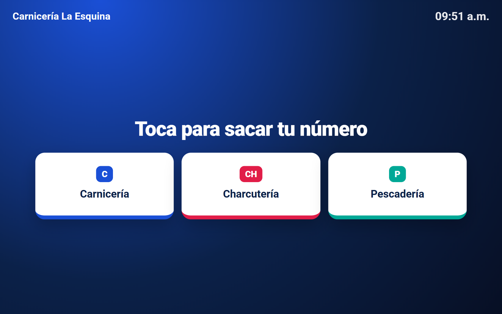
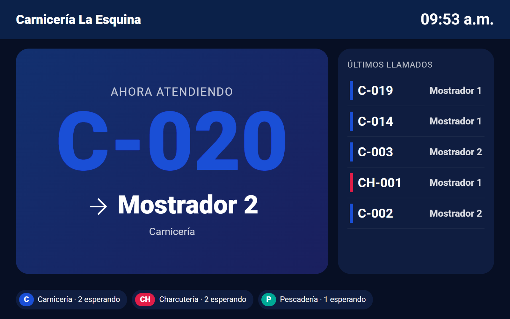
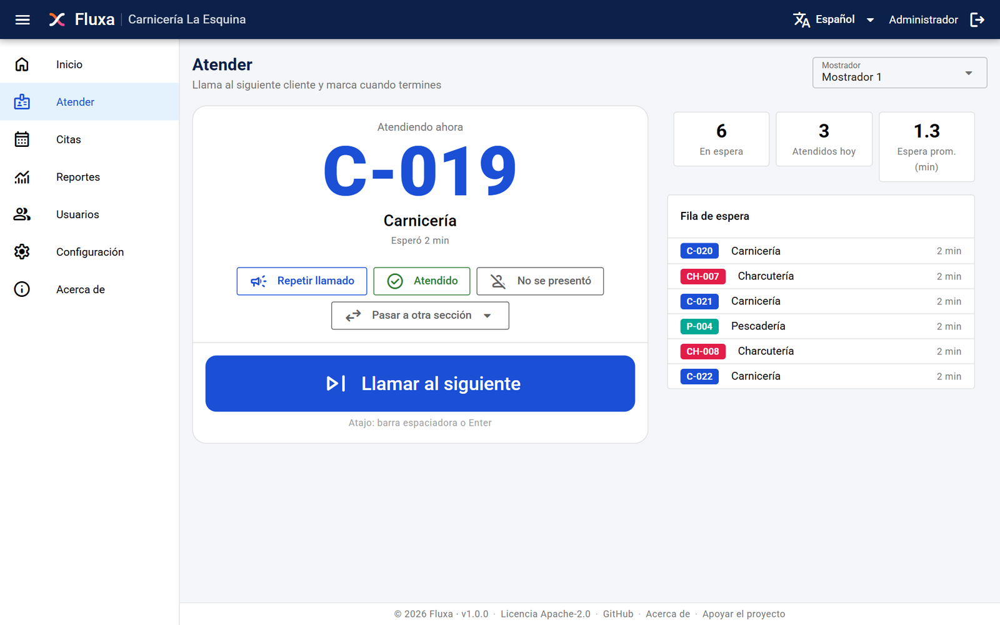
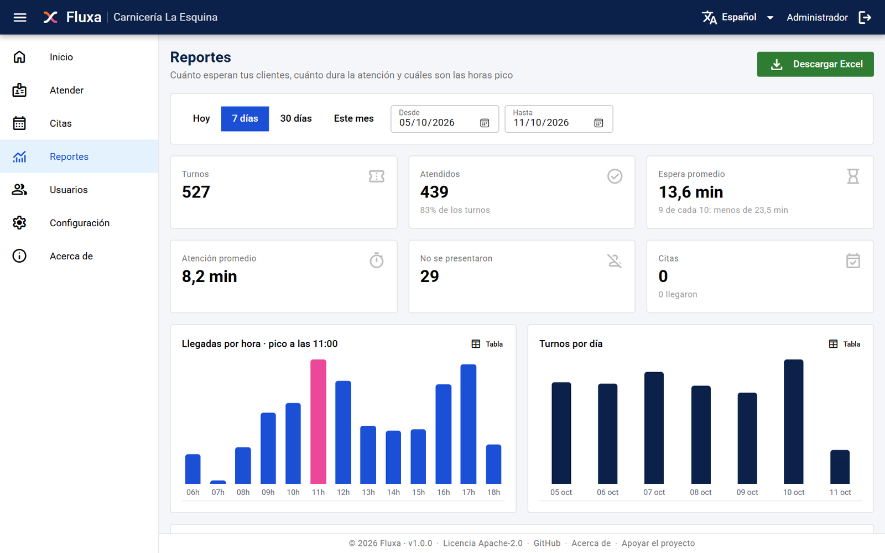
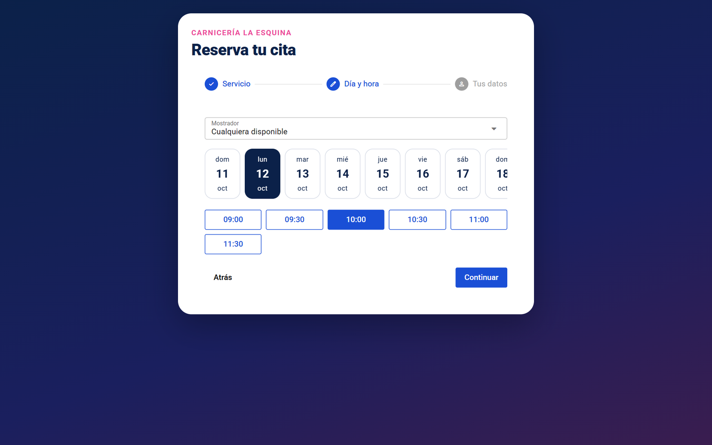
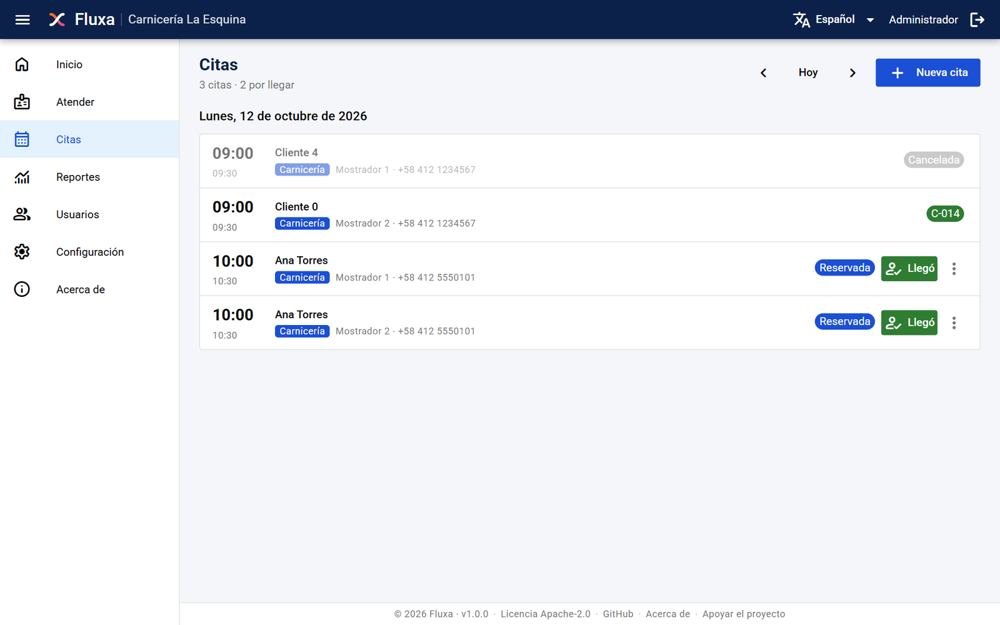
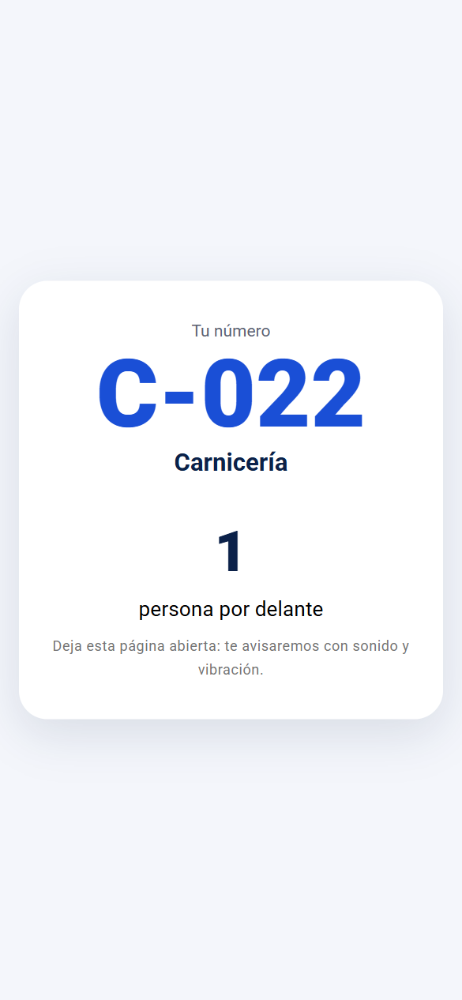
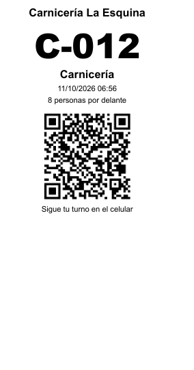

<p align="center">
  
</p>

<p align="center">
  <b>Sistema de turnos y citas open source y autoalojado.</b><br />
  Kiosco, ticketera térmica, pantalla de llamado con voz, seguimiento por QR y reserva de citas, en español, English y português.
</p>

<p align="center">
  <a href="LICENSE"></a>
  
  
  <a href="https://github.com/jmobandod2000/fluxa/releases/latest"></a>
  <a href="https://github.com/jmobandod2000/fluxa/stargazers"></a>
</p>

<p align="center">
  <a href="#instalación">Instalar</a> ·
  <a href="#funcionalidades">Funcionalidades</a> ·
  <a href="#equipos-recomendados">Equipos</a> ·
  <a href="#desarrollo">Desarrollar</a>
</p>

**Fluxa** ordena la atención por orden de llegada y por cita en cualquier negocio: carnicerías, charcuterías, barberías, peluquerías, autolavados, consultorios, farmacias, bancos y oficinas de atención al público. El cliente saca su número en un kiosco, una pantalla lo llama con sonido y voz, sigue su turno desde el celular y, si prefiere, reserva su cita en línea. Se instala en tu propio servidor con un solo comando; tus datos no salen de tu negocio.

Si te resulta útil, **dale una ⭐ al repositorio**: así más negocios lo encuentran.

> 🇺🇸 **English:** Fluxa is an open-source, self-hosted queue management and appointment system for walk-in businesses: kiosk ticketing, thermal printer, call screen with voice, QR tracking, online booking and wait-time reports. Install with one command (`./fluxa install`); Docker is the only requirement.
>
> 🇧🇷 **Português:** Fluxa é um sistema de senhas e agendamento de código aberto e auto-hospedado: totem, impressora térmica, tela de chamada com voz, acompanhamento por QR, agendamento on-line e relatórios. Instale com um comando (`./fluxa install`).

## Capturas

| Kiosco | Pantalla de llamado |
|---|---|
|  |  |
| **Panel para atender** | **Reportes y horas pico** |
|  |  |
| **Reserva de citas** | **Agenda del equipo** |
|  |  |

<p align="center">
  
  &nbsp;&nbsp;
  
</p>

## Funcionalidades

**Turnos**
- **Kiosco** a pantalla completa: el cliente toca su sección y recibe su número (C-015), cuántas personas tiene delante y un QR.
- **Ticketera térmica** de 58 u 80 mm, impresión automática y sin diálogo.
- **Pantalla de llamado** para TV: número grande, puesto, últimos llamados, sonido y **voz** en el idioma configurado.
- **Seguimiento en el celular** por QR: cuántos faltan y aviso con sonido y vibración cuando lo llaman.
- **Panel para atender:** llamar al siguiente (también con la barra espaciadora), repetir llamado, atendido, no se presentó y pasar a otra sección.
- Varios kioscos y puestos a la vez sin números repetidos ni turnos duplicados.

**Citas**
- **Reserva en línea** desde un enlace o QR: servicio, profesional, día y hora.
- **Horario por puesto** (barbero, consultorio, bahía) día por día y duración por servicio.
- **Agenda del equipo**: al marcar "Llegó", la cita entra a la fila **con prioridad**; citas y llegadas sin cita conviven en la misma pantalla.
- Confirmación y recordatorio por correo; enlace para ver o cancelar la cita.

**Gestión**
- **Asistente inicial** con el tipo de negocio: sugiere secciones y vocabulario ("Paciente", "Vehículo", "Silla"…), todo editable.
- **Reportes:** espera y atención promedio, percentil 90, llegadas por hora con el pico resaltado, por día, por sección y por empleado; **descarga a Excel**.
- Sucursales, usuarios administradores y empleados.
- Interfaz en **español, inglés y portugués**.
- Aviso dentro de la app cuando sale una versión nueva.

## Instalación

Solo necesitas **[Docker](https://docs.docker.com/get-docker/)** (Docker Desktop en Windows/macOS, Docker Engine en Linux).

**Opción A — Solo quiero usarlo.** Descarga `fluxa-<versión>.zip` (Windows) o `.tar.gz` (Linux/macOS) desde [Releases](https://github.com/jmobandod2000/fluxa/releases/latest), descomprímelo y dentro de la carpeta ejecuta:

```bash
./fluxa install        # Linux / macOS
fluxa install          # Windows (PowerShell: .\fluxa install)
```

**Opción B — Quiero el código:**

```bash
git clone https://github.com/jmobandod2000/fluxa.git
cd fluxa
./fluxa install
```

El asistente de la terminal pide puerto, dirección, zona horaria, administrador y, opcionalmente, correo y acceso a la base para TablePlus. Al entrar por primera vez, la app te pregunta el tipo de negocio y te deja todo listo.

| Comando | Qué hace |
|---|---|
| `fluxa install` / `config` | Configura y levanta Fluxa / cambia la configuración |
| `fluxa start` / `stop` / `restart` / `status` / `logs` | Operación diaria |
| `fluxa backup` / `restore <archivo>` | Respaldos de la base |
| `fluxa update` | Respaldo, nueva versión y reinicio, sin perder datos |
| `fluxa db` | Datos de conexión a PostgreSQL (TablePlus, DBeaver) |
| `fluxa dev` | Modo desarrollo |

Puerto web por defecto: `8081`. En **Inicio** copias los enlaces del kiosco y la pantalla para abrirlos en cada equipo; el de reservas está en **Configuración → Citas**.

## Equipos recomendados

| Equipo | Uso | Consejo |
|---|---|---|
| Tablet o pantalla táctil | Kiosco en la entrada | Ábrelo en Chrome o Edge en modo kiosco: `--kiosk --kiosk-printing` imprime sin diálogo |
| Ticketera térmica USB 58/80 mm | Ticket impreso | Configúrala como impresora predeterminada del equipo del kiosco; elige el ancho en **Inicio** |
| TV con navegador o mini PC | Pantalla de llamado | Toca la pantalla una vez para activar el sonido (lo exige el navegador) |
| PC o tablet por puesto | Panel para atender | Cada empleado elige su puesto una vez y queda recordado |

## Desarrollo

Requisitos: Node.js 22.22+ (recomendado 24 LTS), pnpm 10 y Docker.

```bash
./fluxa dev            # base en Docker + API y web con recarga automática
```

- Web `http://localhost:9020` · API `http://localhost:3020/api` · Swagger `http://localhost:3020/docs`
- Datos de prueba para reportes: `pnpm demo:history` en `api/`.

Stack: NestJS 10, Prisma 6, PostgreSQL 17, Quasar 2 / Vue 3, eventos en tiempo real con Server-Sent Events.

## Licencia

[Apache-2.0](LICENSE). Copyright 2026 Juan M. Obando. Ver [NOTICE](NOTICE) y [CHANGELOG](CHANGELOG.md).
